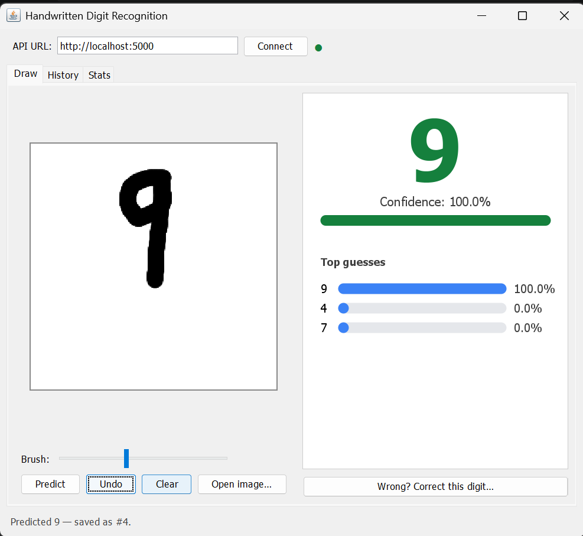

# Handwritten Digit Recognition System

   

**Python · TensorFlow · Flask REST API · PostgreSQL · Java Swing**

Draw a digit in a Java desktop app → it is sent to a Flask REST API → a TensorFlow CNN
predicts the digit → the result is stored in PostgreSQL and shown with its confidence.

```
 ┌────────────────────┐   multipart PNG    ┌───────────────────────┐   SQL    ┌──────────────┐
 │  Java Swing client │ ─────────────────▶ │  Flask REST API       │ ───────▶ │  PostgreSQL  │
 │  canvas · history  │ ◀───────────────── │  validate → preprocess│ ◀─────── │  predictions │
 │  stats · feedback  │   JSON result      │  → TensorFlow CNN     │          └──────────────┘
 └────────────────────┘                    └───────────────────────┘
                                                      ▲
                                      ml/train.py ────┘  trains ml/digit_model.keras on MNIST
```

## Features

| Feature | Where |
|---|---|
| CNN trained on MNIST with built-in data augmentation (typically ≈99% test accuracy on MNIST) | `ml/train.py` |
| Smart preprocessing (invert, crop, centre, scale) so *hand-drawn* digits work, not just MNIST images | `backend/services/prediction_service.py` |
| REST API with validation, proper HTTP status codes and JSON errors | `backend/routes/` |
| PostgreSQL storage via connection pool + repository layer (parameterised SQL) | `backend/database/`, `database/schema.sql` |
| Java Swing GUI: drawing canvas, brush size, undo, open-image, big result display | `client/` |
| **New:** top-3 guesses + full probability vector | `/predict` response |
| **New:** feedback loop — correct a wrong prediction; tracked accuracy | `PATCH /predictions/<id>/feedback` |
| **New:** history browser with delete / clear all / CSV export | History tab, `DELETE`, `/predictions/export` |
| **New:** statistics dashboard (counts per digit, avg confidence, feedback accuracy) | Stats tab, `GET /predictions/stats` |
| **New:** health endpoint + connection indicator in the GUI | `GET /health` |
| **New:** low-confidence warning, keyboard shortcuts (Enter / Esc / Ctrl+Z) | GUI |
| **New:** Postman collection with automated tests | `postman/` |
| **New:** unit tests that need no database or model | `backend/tests/` |
| Graceful degradation: if the DB is down the prediction is still returned (`"saved": false`) | `predict_routes.py` |

## Project layout

```
backend/            Flask API (app.py, routes/, services/, model/, database/, utils/, tests/)
client/             Java Swing client (no third-party dependencies)
database/schema.sql PostgreSQL schema (idempotent — safe to re-run)
ml/                 train.py, test_model.py  (digit_model.keras appears after training)
postman/            Postman collection
samples/            digit_0.png … digit_9.png for quick testing
```

## Setup (first time)

Prerequisites: **Python 3.10–3.12** (TensorFlow does not support the newest Python versions immediately — check
tensorflow.org if install fails), **PostgreSQL 13+**, **JDK 11+**.

### 1. Python environment
```bash
python -m venv venv
source venv/bin/activate          # Windows:  venv\Scripts\activate
pip install -r requirements.txt
```

### 2. Train the model (about 3–10 minutes on CPU)
```bash
python ml/train.py                # quick try:  python ml/train.py --epochs 5
```
Creates `ml/digit_model.keras` and `ml/training_report.json` (accuracy, per-digit accuracy, confusion matrix).
Optional check on one image: `python ml/test_model.py samples/digit_7.png`

### 3. Database
```bash
psql -U postgres -c "CREATE DATABASE digit_recognition;"
psql -U postgres -d digit_recognition -f database/schema.sql
```

### 4. Configure and start the API
```bash
cp backend/.env.example backend/.env      # Windows: copy ...   then edit DB_PASSWORD
./run_backend.sh                          # Windows: run_backend.bat   (or: python backend/app.py)
```
You should see "Model loaded successfully" and "Database connection pool initialized successfully".
Check it: open <http://localhost:5000/health> in a browser.

### 5. Start the Swing client (in a second terminal)
```bash
./run_client.sh                           # Windows: run_client.bat
```
Or with Maven: `cd client && mvn package && java -jar target/digit-client-1.0.0.jar`.
A different API address: `DIGIT_API_URL=http://host:5000 ./run_client.sh`, or type it in the app's URL box.

## API reference

| Method & path | Purpose |
|---|---|
| `GET /health` | `{status, model_loaded, database_connected}` (503 if degraded) |
| `POST /predict` | multipart: `image` (png/jpg/bmp ≤ 2 MB), optional `source` = `canvas`\|`upload` → `{predicted_digit, confidence, top3, probabilities, id, saved}` |
| `GET /predictions?limit=&offset=&digit=` | history, newest first |
| `GET /predictions/<id>` | one prediction (404 if missing) |
| `DELETE /predictions/<id>` | delete one |
| `DELETE /predictions` | clear all |
| `PATCH /predictions/<id>/feedback` | body `{"corrected_digit": 0-9}` |
| `GET /predictions/stats` | aggregate numbers |
| `GET /predictions/export` | CSV download |

Example: `curl -F "image=@samples/digit_7.png" -F "source=upload" http://localhost:5000/predict`

Errors are always `{"success": false, "error": "..."}` with 400 (bad input), 404, 413 (too large),
415 (wrong file type), 422 (unreadable/blank image), 503 (model or DB unavailable).

## Testing

```bash
python -m unittest discover -s backend/tests -v     # 15 tests, no DB / model needed
```
Postman: import `postman/digit-recognition.postman_collection.json`, pick `samples/digit_3.png` in the *Predict*
request, then run the collection (each request has automated assertions).
Java client library check against a running API:
`javac -d client/target/classes client/src/main/java/com/kanchani/digit/*.java && java -cp client/target/classes com.kanchani.digit.ApiSmokeTest http://localhost:5000 samples/digit_3.png`
(⚠ this clears the history table first.)

## Troubleshooting

- **`Model file not found`** → run `python ml/train.py` first.
- **`Could not connect to PostgreSQL`** → is the service running? Check `DB_*` in `backend/.env`.
- **`column "source" does not exist`** → you have the old table; re-run `schema.sql` (it adds the new columns).
- **Wrong predictions on drawings** → draw the digit large, with a thick stroke, using the *whole* canvas;
  use *Correct this digit* so the Stats tab shows real-world accuracy.
- **Swing window doesn't open on a server/WSL** → it needs a desktop (GUI) session.

## Ideas for further work

Retrain using the corrected predictions (store the images too), Docker Compose for API + Postgres,
API-key auth, a web front-end that reuses the same API.
